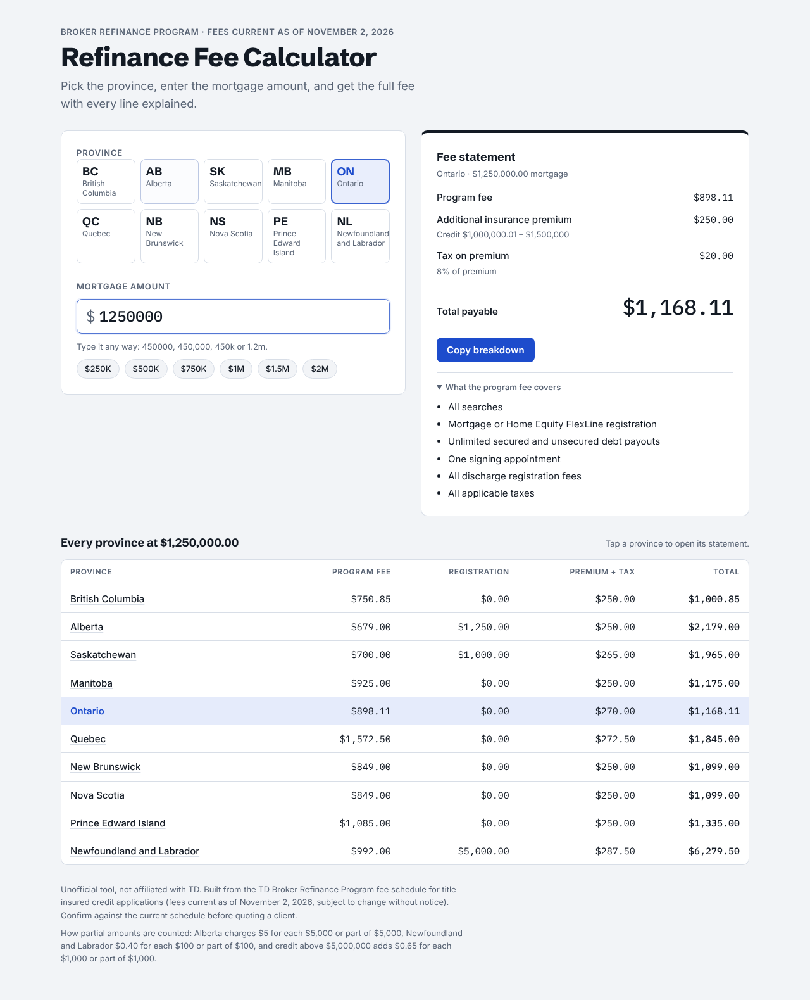

# Refinance Fee Calculator

A fast, friendly calculator for the **TD Broker Refinance Program fee schedule** (title insured credit applications, fees current as of **November 2, 2026**). Pick a province, type a mortgage amount, and get the full fee with every line explained.



## What it does

- **All ten provinces.** Program fee, registration fee, additional title insurance premium and tax on premium are calculated by province.
- **Accepts amounts the way people type them.** `450000`, `450,000`, `$450k`, `1.2m` and `2.5 million` all work.
- **Shows every line of the fee.** Each line shows how it was worked out, for example "$5 × 90 blocks of $5,000" or "Credit $1,000,000.01 – $1,500,000".
- **Quebec options.** Choose *no discharge* or *with discharge*. The price is the same, but what the fee covers changes.
- **Compares every province** at the same amount. Click a province name to open its statement.
- **Copies the breakdown** as plain text you can paste into an email or file note.
- Works on phones, supports keyboard use and screen readers, follows your light or dark theme, and remembers your last inputs.

## Fee rules implemented

| Component | Rule |
|---|---|
| Program fee | BC $750.85 · AB $679 · SK $700 · MB $925 · ON $898.11 · NB $849 · NS $849 · NL $992 · PE $1,085 · QC $1,572.50 |
| Registration: Alberta | $5 per $5,000 of the mortgage amount |
| Registration: Newfoundland and Labrador | $0.40 per $100 of the mortgage amount |
| Registration: Saskatchewan | Variable chart: $200 / $275 / $525 / $775 / $1,000 |
| Additional premium (credit over $750,000) | $100 to $1M · $250 to $1.5M · $350 to $2M · $750 to $5M · $750 + $0.65 per $1,000 over $5M |
| British Columbia | Premium applies only above $1,000,000 |
| Tax on premium | ON 8% · NL 15% · SK 6% · QC 9% · MB 0% (matches every value in the published table) |

**How partial amounts are counted.** The schedule doesn't say how to handle part of a block, so the calculator follows the usual land-registry convention: part of a block counts as a full block. For example, $312,500 in Alberta is 63 blocks of $5,000, so the fee is $315. Above $5M the schedule says the tax "varies", so the calculator applies the provincial rate and shows a reminder to confirm before quoting.

## Built test-first (TDD)

The commit history shows the red → green cycle:

1. `test: add failing specs …(red)`: 111 unit specs written from the fee schedule, line by line, before any logic existed.
2. `feat: implement fee engine …(green)`: the fee engine makes them pass.
3. `test: add failing browser specs …(red)`: 10 Playwright specs that use the page the way a person would.
4. `feat: build the calculator page (green)`: the UI makes them pass. The phone-width and screen-reader specs caught two real bugs along the way.

The fee engine (`src/fees.js`) is a pure module with no DOM access, and it does all its arithmetic in **integer cents** so totals never drift.

```
src/fees.js     fee engine (pure, no DOM)
src/format.js   amount parsing and currency formatting
src/app.js      page wiring and rendering
test/unit/      node:test specs for the engine and parsing
test/e2e/       Playwright specs for the real page
```

## Run it locally

Requires Node 20 or later. There are no runtime dependencies.

```bash
git clone https://github.com/iftemum/FCT-Fee-Calculator.git
cd FCT-Fee-Calculator
npm start            # http://localhost:4173
npm test             # unit tests
npm install && npx playwright install chromium
npm run test:e2e     # browser tests
```

## Disclaimer

This is an unofficial tool and is not affiliated with TD. Fees are subject to change without notice, so always confirm against the current fee schedule before quoting a client.
